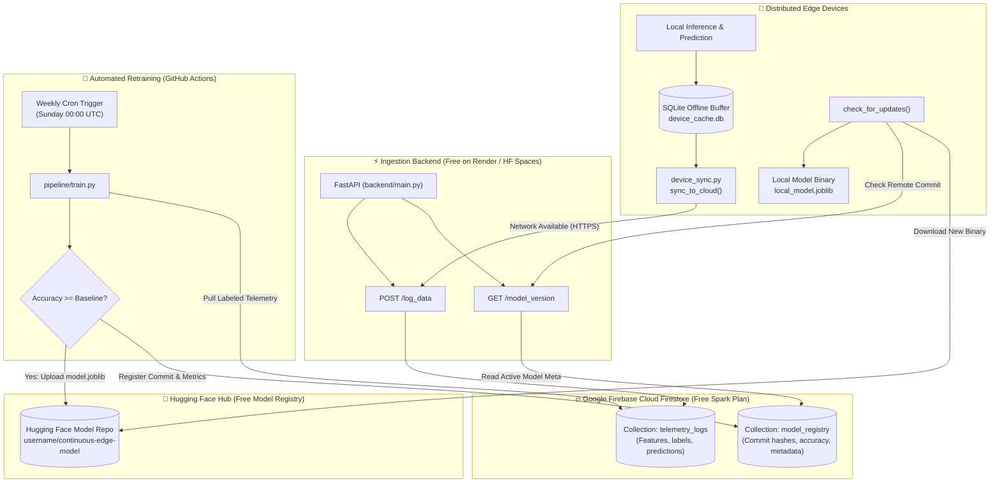

# 🚀 100% Free Continuous-Learning Edge ML Architecture (Firebase Edition)

A production-ready, zero-cost continuous machine learning system featuring edge offline inference, automated telemetry ingestion into **Google Firebase Cloud Firestore**, scheduled serverless retraining via **GitHub Actions**, and over-the-air (OTA) model distribution through **Hugging Face Hub**.

---

## 🏛️ System Architecture



---

## 🔑 Configured Credentials

* **Google Client ID / Token**: `666870518780-2b5u95ma67ovhlon6suprpgvjanhnsnr.apps.googleusercontent.com`
* **Default Firebase Project ID**: `pulse-ai-portal`

---

## 📁 Repository File Structure

```text
├── backend/
│   ├── main.py               # FastAPI backend with Firebase Firestore integration
│   ├── requirements.txt      # fastapi, uvicorn, firebase-admin, google-cloud-firestore
│   ├── Dockerfile            # Container definition for Render & Hugging Face Spaces
│   └── .env.example          # Sample environment variables for backend
├── client/
│   ├── device_sync.py        # Edge client: SQLite offline buffering & OTA updates
│   ├── simulate_fleet.py     # Multi-device simulation with network dropout resilience
│   └── requirements.txt      # requests, joblib, scikit-learn, numpy
├── pipeline/
│   ├── train.py              # Headless retraining script with performance gating
│   ├── bootstrap_data.py     # Seeds synthetic labeled telemetry to Firestore
│   ├── requirements.txt      # firebase-admin, scikit-learn, pandas, huggingface_hub
│   └── .env.example          # Sample environment variables for pipeline
├── firebase/
│   └── firestore.rules       # Security rules for Firestore collections
├── .github/workflows/
│   └── retrain.yml           # GitHub Actions weekly cron & manual dispatch workflow
└── README.md                 # Complete step-by-step free deployment guide
```

---

## 🛠️ Step-by-Step 100% Free Deployment Guide

### Step 1: Configure Google Firebase Cloud Firestore
1. Go to the [Firebase Console](https://console.firebase.google.com).
2. Select your project (e.g. `pulse-ai-portal`) or create a new one on the **Free Spark Plan** (includes 1GB storage and 50,000 document reads / 20,000 document writes per day free).
3. Navigate to **Firestore Database** -> Click **Create Database** (Start in production mode).
4. Apply the security rules from [firebase/firestore.rules](file:///c:/Users/AISHWARYA/Desktop/pulse/firebase/firestore.rules):
   ```javascript
   rules_version = '2';
   service cloud.firestore {
     match /databases/{database}/documents {
       match /telemetry_logs/{logId} { allow read, write: if true; }
       match /model_registry/{versionId} { allow read, write: if true; }
     }
   }
   ```
5. *(Optional for Serverless/Service Account)*:
   - Navigate to **Project Settings** -> **Service accounts**.
   - Click **Generate new private key** to download your JSON credentials file.
   - You can copy its JSON text into `FIREBASE_SERVICE_ACCOUNT` or set the file path.

---

### Step 2: Set Up Hugging Face Hub (Free Model Storage)
1. Sign up for free at [huggingface.co](https://huggingface.co).
2. Create a new model repository at [huggingface.co/new](https://huggingface.co/new):
   - **Repository Name**: `continuous-edge-model`
   - **Visibility**: Public (or Private)
3. Generate an Access Token with **Write** permission:
   - Navigate to **Settings** -> **Access Tokens** -> **Create New Token**.
   - Set scope to **Write** and copy the token (`hf_...`).

---

### Step 3: Deploy the FastAPI Backend for Free

#### Option A: Deploy to Render (Recommended)
1. Push this repository to GitHub.
2. Sign in to [render.com](https://render.com) (free tier includes 750 free instance hours/month).
3. Click **New +** -> **Web Service** -> Connect your GitHub repo.
4. Settings:
   - **Runtime**: Python 3 (or Docker using [backend/Dockerfile](file:///c:/Users/AISHWARYA/Desktop/pulse/backend/Dockerfile))
   - **Root Directory**: `backend`
   - **Build Command**: `pip install -r requirements.txt`
   - **Start Command**: `uvicorn main:app --host 0.0.0.0 --port $PORT`
5. Add Environment Variables:
   - `FIREBASE_PROJECT_ID`: `pulse-ai-portal`
   - `GOOGLE_CLIENT_ID`: `666870518780-2b5u95ma67ovhlon6suprpgvjanhnsnr.apps.googleusercontent.com`
   - `HF_REPO_ID`: `your-username/continuous-edge-model`
   - `HF_MODEL_FILENAME`: `model.joblib`
   - `FIREBASE_SERVICE_ACCOUNT`: *(paste contents of serviceAccountKey.json if using private service account)*
6. Click **Deploy Web Service** to get your live URL: `https://your-app.onrender.com`.

---

### Step 4: Configure GitHub Actions Secrets
In your GitHub repo, go to **Settings** -> **Secrets and variables** -> **Actions** -> **New repository secret**:

| Secret Name | Value Example | Description |
|---|---|---|
| `FIREBASE_PROJECT_ID` | `pulse-ai-portal` | Your Firebase project ID |
| `FIREBASE_SERVICE_ACCOUNT` | `{"type": "service_account", ...}` | Firebase private key JSON string |
| `GOOGLE_CLIENT_ID` | `666870518780-2b5u95ma67ovhlon6suprpgvjanhnsnr.apps.googleusercontent.com` | Google OAuth Client Token |
| `HF_TOKEN` | `hf_AbCdEf12345...` | Hugging Face Access Token (Write) |
| `HF_REPO_ID` | `your-username/continuous-edge-model` | Target Hugging Face model repository |

The workflow at [.github/workflows/retrain.yml](file:///c:/Users/AISHWARYA/Desktop/pulse/.github/workflows/retrain.yml) triggers **every Sunday at 00:00 UTC** and on-demand via **Actions -> Run workflow**.

---

### Step 5: Edge Client Execution & Offline Resilience

#### 1. Quick Local Test
```bash
# Seed initial training data to Firestore
python pipeline/bootstrap_data.py 50

# Run multi-device fleet simulation with network outages
python client/simulate_fleet.py
```

#### 2. Using in Edge Applications
```python
from client.device_sync import DeviceSyncManager

client = DeviceSyncManager(
    backend_url="https://your-app.onrender.com",
    device_id="sensor_node_01"
)

# 1. Prediction (offline-safe via local model with fallback)
features = [1.25, -0.32, 0.44, -1.02]
pred = client.predict_and_cache(features, true_label=1)
print(f"Prediction: {pred}")

# 2. Cloud Synchronization
# (If offline, logs are retained safely in local SQLite device_cache.db)
sync_result = client.sync_to_cloud()
print(f"Sync: {sync_result}")

# 3. Over-the-air (OTA) Model Update
# Checks backend GET /model_version and downloads new binary if available
updated = client.check_for_updates()
print(f"Updated: {updated}")
```

---

## 🛡️ Production Resilience Features

1. **Zero Data Loss on Edge**: When Wi-Fi/cellular connection drops, `device_sync.py` stores all feature vectors and labels locally in `device_cache.db`. Logs are only cleared once Firebase receives them.
2. **Atomic Model Replacement**: Incoming models from Hugging Face are downloaded to a `.tmp` file and checked for deserialization validity before replacing `local_model.joblib`.
3. **Accuracy Degradation Gate**: `pipeline/train.py` evaluates candidate models against active models in Firestore `model_registry`. Regressed models are discarded automatically.
4. **Firebase Firestore Batching**: All document insertions and updates utilize Firestore batched operations (up to 400 documents per atomic commit).
